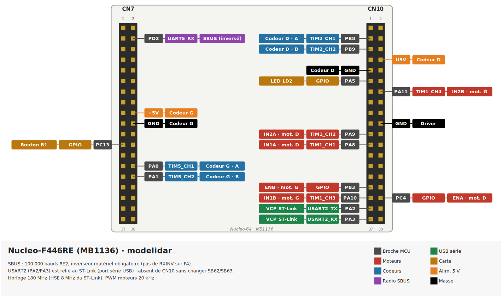

# modelidar

Firmware Rust ([Embassy](https://embassy.dev)) de la base mobile d'un robot à deux roues
motrices, sur carte STM32 Nucleo-64 :

- pilotage de deux moteurs à courant continu par un driver DBH-12V (DBH-1A) ;
- odométrie par codeurs en quadrature ;
- commande depuis un PC par la liaison série USB, ou par une radiocommande SBUS qui
  peut prendre la main ;
- sécurités : arrêt si le PC se tait, si la radio est perdue ou si une roue est bloquée.



## Matériel

| Élément        | Détail                                                                 |
|----------------|------------------------------------------------------------------------|
| Carte          | Nucleo-F446RE (par défaut), Nucleo-F411RE ou Nucleo-L476RG, base MB1136 |
| Driver moteurs | DBH-12V / DBH-1A, 2 voies, 5–12 V, 30 A par voie                       |
| Codeurs        | quadrature, 544 pas par tour de roue                                   |
| Radiocommande  | récepteur SBUS (FrSky, OpenTX…)                                        |

Le brochage de chaque carte et du driver est dans [`pinouts/`](pinouts/), le câblage
dans [`wires/`](wires/), les caractéristiques des cartes dans
[`STM32-flavor.md`](STM32-flavor.md).

Sur F446 et F411, le SBUS (signal inversé) demande un inverseur matériel : les USART du
STM32F4 ne savent pas inverser la réception. Sur L476, l'inversion est faite par l'USART.

## Compiler et flasher

Prérequis :

```sh
rustup target add thumbv7em-none-eabihf
cargo install probe-rs-tools --locked
cargo install flip-link
```

Nucleo-F446RE (par défaut) :

```sh
cargo run --release
```

Autres cartes : choisir la feature et la puce de probe-rs.

```sh
PROBE_RS_CHIP=STM32F411RE cargo run --release --no-default-features --features stm32f411re
PROBE_RS_CHIP=STM32L476RG cargo run --release --no-default-features --features stm32l476rg
```

Les logs (`defmt`) s'affichent dans le terminal de `cargo run`.

## Protocole série

USART2, relié au port série USB du ST-Link (`/dev/ttyACM0`), 115 200 bauds 8N1.

| Trame        | Effet                                                              |
|--------------|--------------------------------------------------------------------|
| `?`          | demande l'état                                                     |
| `#AAAA,BBBB` | consigne gauche, droite sur 4 chiffres, de `0000` à `1000`, `0500` = arrêt |
| `/`          | arrêt en roue libre                                                |
| `*`          | freinage                                                           |

Chaque trame reçoit une réponse :

```text
!0700,0600 L:+600,+420 R:+300,+210 C:USB F:-
```

| Champ        | Signification                                                     |
|--------------|-------------------------------------------------------------------|
| `!AAAA,BBBB` | consigne réellement appliquée aux moteurs                         |
| `L:` / `R:`  | roue gauche / droite : vitesse (pas/s), position cumulée (pas)    |
| `C:`         | qui pilote : `USB`, `RC` (radiocommande) ou `LOST` (radio perdue) |
| `F:`         | défaut : `-`, `USB_TIMEOUT` ou `STALL`                            |

Pendant que les moteurs tournent, le PC doit envoyer une trame au moins toutes les
500 ms (un `?` suffit), sinon la carte arrête les moteurs.

## Radiocommande

| Voie | Rôle                                              |
|------|---------------------------------------------------|
| CH1  | direction                                         |
| CH2  | avance / recul                                    |
| CH5  | prise de main : la radio pilote en position haute |

- Interrupteur CH5 en haut : la radio pilote, les commandes USB sont ignorées.
- Interrupteur relâché : arrêt des moteurs, l'USB reprend la main.
- Radio perdue pendant la prise de main (failsafe du récepteur ou 100 ms sans trame) :
  arrêt, et l'USB reste bloqué jusqu'au retour de la radio interrupteur relâché.

Les voies se règlent en tête de [`src/tasks/sbus.rs`](src/tasks/sbus.rs).

## Sécurités

Réglables en tête de [`src/tasks/motors.rs`](src/tasks/motors.rs) :

- **PWM plafonné à 98 %**, limite du driver DBH-1A.
- **PC muet** : sans trame USB pendant 500 ms alors que les moteurs tournent, arrêt
  (`F:USB_TIMEOUT`).
- **Roue bloquée** : consigne d'au moins 30 % et roue sous 0,1 tour/s pendant 300 ms,
  arrêt (`F:STALL`). Les moteurs restent arrêtés jusqu'à une consigne neutre (`/`, `*`,
  `#0500,0500` ou manches au centre). `STALL_DETECTION = false` désactive la
  détection, pour un essai sans codeurs.
- **Watchdog** matériel (IWDG, 1 s) qui surveille les tâches moteurs, odométrie et
  SBUS : si l'une d'elles ne tourne plus, la carte redémarre. Au démarrage, la carte
  envoie la cause du dernier reset sur la liaison série, par exemple
  `MCU started (reset: watchdog)`. Le watchdog est gelé quand un débogueur arrête le
  processeur (point d'arrêt, pas à pas).

## Télécommande en terminal

[`tools/teleop`](tools/teleop/) pilote le robot depuis le clavier et affiche son état
(consigne, vitesse des roues, pilote, défaut), en utilisant le protocole ci-dessus.

```sh
cd tools/teleop
cargo run --release                          # premier /dev/ttyACM*
cargo run --release -- --port /dev/ttyACM1
```

Flèches : avancer, reculer, tourner. Espace : neutre. `s` ou `/` : roue libre.
`b` ou `*` : freinage.
`q` : quitter (envoie un arrêt).

## Schémas

- [`pinouts/`](pinouts/) : brochage des cartes et du driver, générés avec
  [pinout](https://pinout.readthedocs.io/). `make` dans le dossier (utilise `uv`).
- [`wires/`](wires/) : câbles, générés avec [WireViz](https://github.com/wireviz/WireViz).
  `make` dans le dossier.

## Organisation du code

```text
src/
├── main.rs            lancement des tâches
├── board/             une configuration par carte (horloges, broches, DMA)
│   ├── mod.rs         partie commune : structure Board, moteurs, config SBUS
│   ├── f446.rs
│   ├── f411.rs
│   └── l476.rs
├── state.rs           odométrie partagée
└── tasks/
    ├── motors.rs      arbitrage USB / radio, sécurités, commande des moteurs
    ├── odometry.rs    lecture des codeurs
    ├── uart_usb.rs    protocole série
    ├── sbus.rs        récepteur de radiocommande
    └── watchdog.rs
tools/teleop/          télécommande en terminal (PC)
pinouts/  wires/       schémas
doc/                   liens vers les datasheets, photos, schéma Fritzing
```

## Licence

Ce projet est distribué sous l'une ou l'autre de ces licences, au choix :

- Apache License, Version 2.0 ([LICENSE-APACHE](LICENSE-APACHE))
- MIT ([LICENSE-MIT](LICENSE-MIT))

Sauf mention contraire explicite, toute contribution soumise pour inclusion dans ce
projet, au sens de la licence Apache-2.0, est distribuée sous cette double licence,
sans condition supplémentaire.

Les datasheets ne sont pas incluses : [`doc/README.md`](doc/README.md) donne les liens
vers les documents officiels.
